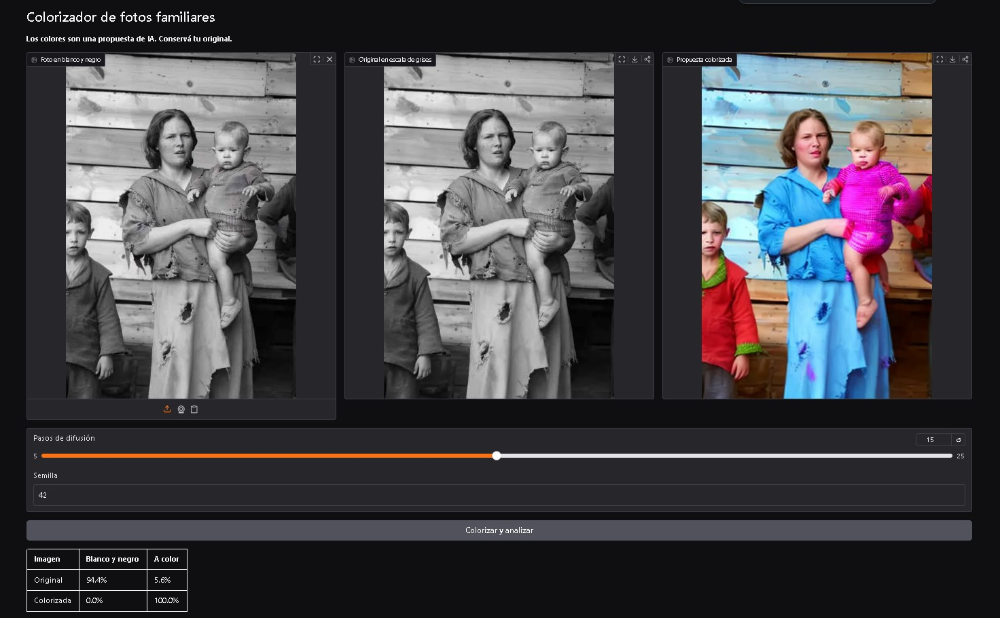
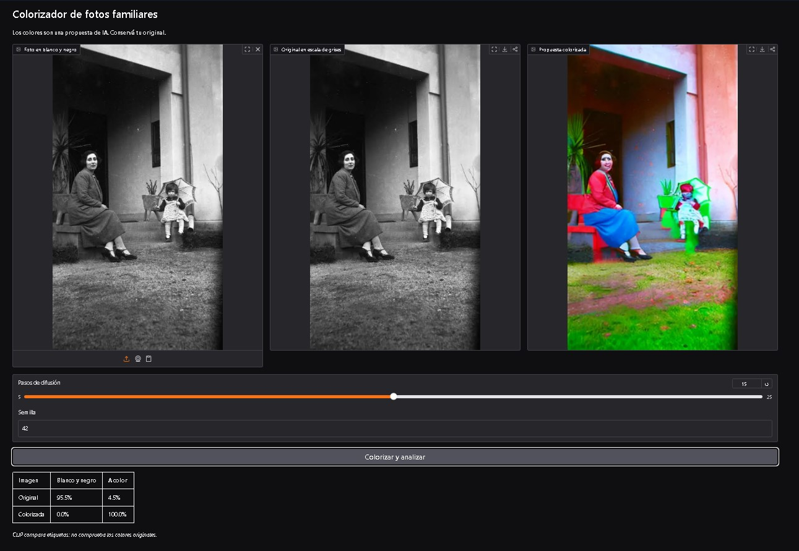
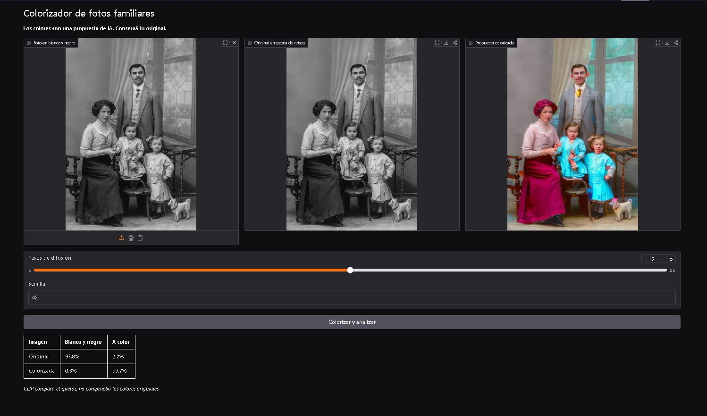
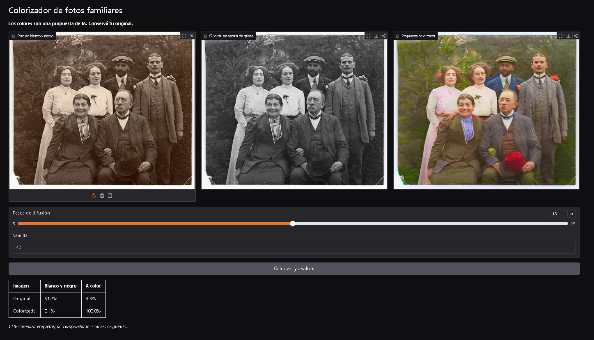
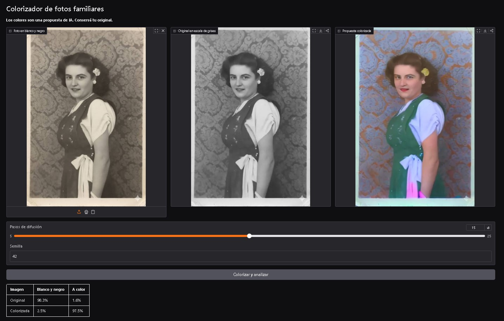

# Colorizador de fotos familiares

Proyecto integrador para explorar la colorización de fotografías familiares
antiguas en blanco y negro. La idea es crear una herramienta sencilla que
permita comparar el original con una versión colorizada por inteligencia
artificial y entender qué partes del resultado fueron estimadas.

> **Estado actual:** el proyecto incluye el cuaderno paso a paso, `app.py` y el
> entorno local con `uv`. Los pesos cargaron en la computadora, pero la
> inferencia local por CPU es imprácticamente lenta: las capturas recientes
> muestran 2 h 32 min para 15 pasos y 2 h 43 min para 8 pasos. Una salida
> anterior del cuaderno registró cerca de 6 horas para 15 pasos; las mediciones
> no son un benchmark estandarizado. En Spaces todavía falta registrar el
> hardware y los tiempos.

## Problema y usuario

Muchas familias conservan álbumes antiguos con fotografías en blanco y negro.
Quieren verlas a color y compartirlas, pero no cuentan con los colores
originales de la ropa, los objetos ni el entorno.

**Persona usuaria de diseño (hipótesis ficticia, pendiente de validar):**

- **Nombre:** Ana.
- **Contexto:** integrante de una familia que está digitalizando un álbum
  heredado. Usa una computadora y aplicaciones sencillas, pero no sabe editar
  imágenes ni trabajar con modelos de IA.
- **Problema:** quiere ver cómo podrían verse a color algunas fotos familiares
  antiguas, pero desconoce los colores originales.
- **Objetivo:** probar una colorización fácil, comparar el resultado con el
  original y guardar la imagen sin confundir una estimación con un dato
  histórico.
- **Frustración y riesgo:** le preocupa que la herramienta cambie detalles de
  sus familiares o presente colores inventados como verdaderos.
- **Contexto de uso:** en casa, con una foto escaneada y una computadora.

Esta persona es un perfil de diseño, no el resultado de una entrevista. Antes
de entregar, validá si representa a una persona real y anotá qué aprendiste de
esa prueba.

**Alcance inicial:** colorizar fotos en blanco y negro. La primera versión no
intentará reparar rayas, manchas, desenfoque ni daños físicos.

## Qué queremos construir

El MVP tiene este flujo:

1. Cargar una foto en blanco y negro.
2. Procesarla con un modelo de difusión disponible en Hugging Face.
3. Comparar el original y la versión colorizada.
4. Mostrar un análisis visual de Hugging Face y explicar sus limitaciones.
5. Revisar la propuesta junto al original y decidir si conservarla.


## Principio central: restaurar no es recuperar

La foto original contiene información de luminosidad y formas, pero no registra
el color de la escena. El modelo propondrá colores plausibles a partir de lo que
aprendió; **no recuperará los colores originales**. Una salida puede verse
creíble sin ser verificable.

La interfaz actual muestra el original junto a la propuesta y advierte que los
colores son una propuesta de IA. No incluye un mapa de diferencias ni un control
de intensidad del cambio; el control de pasos modifica el costo/tiempo de la
generación, no es un control de intensidad. CLIP tampoco comprueba colores.
Para verificar un color haría falta una fuente independiente, por ejemplo,
otra fotografía o un documento.

## Modelos y limitaciones

- **Difusión:** `neurallove/controlnet-sd21-colorization-diffusers`, cargado con
  Diffusers y fijado a la revisión
  `2083978ca9345c9edac3af2779c17710b7e42258`. El repositorio declara licencia
  OpenRAIL y su peso principal ocupa aproximadamente 1,46 GB. Su ficha contiene
  muy poca información sobre entrenamiento y evaluación; los resultados deben
  tratarse como experimentales.
- **Modelo base:** `sd2-community/stable-diffusion-2-1-base`, revisión
  `4e63672c03103b6c636b8fb4119ba982469b2955`. El Hub indica que es público,
  no restringido y compatible con Diffusers. Declara licencia OpenRAIL++-M.
  No requiere token; la primera descarga ocupa varios GB.
- **Análisis visual:** `openai/clip-vit-base-patch32`, comparando afinidad con
  las etiquetas “fotografía en blanco y negro” y “fotografía a color”. CLIP no
  verifica la calidad ni la autenticidad de los colores. La ficha de Hugging
  Face lo presenta como un modelo de investigación y advierte que su uso debe
  evaluarse para cada contexto. La ficha y sus metadatos consultados no indican
  una licencia. El código todavía no fija una revisión para CLIP; esto limita
  la reproducibilidad exacta de ese componente. Revisá las condiciones antes
  de redistribuirlo.

El flujo del cuaderno no desactiva el filtro de seguridad del pipeline. No
incluye credenciales ni usa APIs de pago. La primera prueba debe hacerse con una
imagen que no sea privada.

## Arquitectura del MVP

```text
Persona usuaria
      ↓
Gradio (local o Hugging Face Space)
      ↓
Foto → preparación en escala de grises y ajuste de tamaño
      ↓
ControlNet + Stable Diffusion 2.1
      ↓
CLIP: afinidad con dos etiquetas
      ↓
Original + propuesta colorizada + advertencia
```

Los modelos se cargan una vez al iniciar la app. Cada solicitud prepara la
imagen, ejecuta la difusión y luego analiza el original y la propuesta con
CLIP. La interfaz muestra el original y la propuesta en paralelo.

## Tecnologías y dependencias

El entorno se declara en [pyproject.toml](./pyproject.toml) y las versiones
exactas quedan registradas en [uv.lock](./uv.lock).

| Dependencia directa | Uso previsto |
|---|---|
| `torch` | Cálculos del modelo. En esta computadora se instaló la versión **CPU**, porque no se detectó una GPU CUDA. |
| `diffusers` | Cargar y ejecutar el pipeline de difusión. |
| `transformers` | Cargar el modelo de Hugging Face para el análisis visual. |
| `accelerate` | Apoyo para ejecutar modelos y gestionar el dispositivo disponible. |
| `safetensors` | Lectura de pesos de modelos en formato Safetensors, si el modelo elegido los ofrece. |
| `gradio` | Construir la interfaz web local. |
| `pillow` | Abrir, convertir y mostrar imágenes. |
| `numpy` | Operaciones numéricas auxiliares con imágenes. |
| `ipykernel` *(grupo `notebook`)* | Ejecutar cuadernos Jupyter desde el entorno virtual del proyecto. |

Las dependencias transitivas también quedan fijadas en `uv.lock`; no hace falta
instalarlas una por una.

## Requisitos

- Windows y Python **3.12**.
- `uv`, el gestor de proyectos y entornos de Python.
- Conexión a Internet durante la primera instalación y al descargar modelos.
- Espacio libre en **E:** para el entorno, las dependencias y los pesos de los
  modelos.

**Hardware local registrado:** Windows, PyTorch `2.15.0+cpu`, CUDA no
disponible; no se registraron RAM ni VRAM. Las dos capturas locales muestran
2 h 32 min 34 s para 15 pasos y 2 h 43 min 20 s para 8 pasos. Una salida
anterior registra cerca de 6 horas para otra generación de 15 pasos. Las
condiciones de estas ejecuciones no están completamente registradas y no son
comparables como benchmark; en conjunto, evidencian que la inferencia local por
CPU es demasiado lenta para el uso previsto.

La app también se prueba en un Hugging Face Space con GPU. Registrá más abajo
el hardware exacto del Space y los tiempos medidos allí; el hardware de pago
puede generar cargos mientras el Space está activo. Para fotos familiares,
considerá que subir una imagen al Space la envía a un servicio remoto.

## Instalación paso a paso en PowerShell

Abrí PowerShell y ejecutá los comandos desde la raíz del proyecto:

```powershell
Set-Location 'E:\ifts24-lab-pdi-2026\TP2'

# Guardar la caché de paquetes, los modelos y los temporales en E:
$env:UV_CACHE_DIR = "$PWD\.uv-cache"
$env:HF_HOME = "$PWD\.model-cache\huggingface"
$env:TORCH_HOME = "$PWD\.model-cache\torch"
$env:GRADIO_TEMP_DIR = "$PWD\.model-cache\gradio"

# Crear/sincronizar el entorno virtual y agregar soporte para cuadernos
uv sync --group notebook

# Registrar el kernel Jupyter del proyecto dentro de .venv
uv run --group notebook python -m ipykernel install --user --name colorizador-fotos --display-name "Python 3.12 (colorizador-fotos)"
```


### Comprobar el entorno

```powershell
uv run --group notebook python -c "import sys, torch, diffusers, transformers, gradio, PIL, numpy, ipykernel; print(sys.executable); print('Torch:', torch.__version__); print('CUDA disponible:', torch.cuda.is_available())"
```

La primera línea debe apuntar a:

```text
E:\ifts24-lab-pdi-2026\TP2\.venv\Scripts\python.exe
```

En VS Code, seleccioná **Python 3.12 (colorizador-fotos)** como kernel del
cuaderno. El grupo `notebook` instala `ipykernel`; el comando anterior registra
el nombre de kernel para este proyecto.

## Ejecutar localmente

1. Abrí una terminal en la raíz del proyecto y seguí la instalación anterior.
2. Ejecutá `uv run app.py`.
3. Abrí la dirección local que muestra Gradio, cargá una imagen y pulsá
   **Colorizar y analizar**.

La primera ejecución descarga los pesos. En esta computadora el procesamiento
local usa CPU y puede tardar horas; por eso la evaluación de tiempos se hará en
el Space con GPU. El cuaderno de desarrollo está en
[pipeline_colorizacion_fotos.ipynb](./pipeline_colorizacion_fotos.ipynb).

## Probar en Hugging Face Spaces

1. Creá un Space con SDK **Gradio** y elegí un hardware con GPU.
2. Subí a la raíz del Space `app.py` y `requirements.txt`. No subas `.venv`,
   `.model-cache`, tokens ni fotos de prueba con datos personales.
3. Esperá que termine la construcción y la descarga de los modelos. La primera
   carga puede demorar más que las siguientes.
4. Probá las imágenes y anotá el hardware exacto configurado, el tiempo de
   arranque, el tiempo de cada generación, los pasos y los resultados.
5. Pausá o bajá el hardware cuando termines para evitar cargos.

Al usar el Space, las imágenes se envían a Hugging Face para procesarse. Usá
imágenes propias con permiso o ejemplos no sensibles. La app muestra resultados
generados y CLIP; no verifica los colores históricos.

## Pruebas y resultados

Se revisaron **quince ejecuciones en Hugging Face Spaces sobre cinco fotos
distintas**, probando combinaciones de pasos y semillas. Las capturas del Space
no muestran el hardware ni el tiempo de generación; esos datos quedan
pendientes. También se agregó `images_6.jfif`, pero todavía no hay una captura
de su resultado, por lo que no se cuenta como una prueba.

| Foto de prueba | Ejecuciones (pasos / semilla) | CLIP original en gris: BN / color | CLIP colorizada: BN / color | Observación visual |
|---|---|---|---|---|
| `images_1.jfif` — mujer con dos niños | 15/42, 25/60, 25/80 | 94.4% / 5.6% | 0.0%/100.0%, 0.0%/100.0%, 0.1%/100.0% | La escena se conserva en términos generales, pero la ropa de la mujer y el bebé cambia entre azul, magenta, turquesa y verde. Los colores son intensos y no se pueden verificar. |
| `images_2.jfif` — mujer y niña en un jardín | 25/80, 25/60, 15/42 | 95.5% / 4.5% | No visible en una captura; 0.2%/99.8%, 0.0%/100.0% | Cambian los colores de la ropa y el césped/fondo entre ejecuciones. En algunas zonas aparecen colores muy saturados y manchas magenta; son detalles generados, no evidencia del color real. |
| `images_3.jfif` — familia con perro | 25/80, 25/50, 15/42 | 97.8% / 2.2% | 1.3%/98.7%, 2.9%/97.1%, 0.3%/99.7% | La escena y las personas se mantienen reconocibles, pero la ropa y el fondo reciben colores fuertes. Los colores de las prendas y la ventana cambian entre ejecuciones. |
| `images_4.jfif` — retrato grupal al aire libre | 15/42, 25/50, 25/80 | 91.7% / 8.3% | 0.1%/100.0%, 0.1%/99.9%, 0.3%/99.7% | La entrada sepia se convierte a grises; el follaje y la vestimenta reciben colores saturados. No se pueden verificar esos colores con la información disponible. |
| `images_5.jfif` — retrato individual | 19/80, 25/50, 15/42 | 98.3% / 1.6% | 3.0%/97.0%, 4.1%/95.8%, 2.5%/97.5% | La persona y la pose se mantienen en términos generales; cambian los colores del vestido, el fondo y el adorno. En una salida se ve una zona magenta intensa junto al borde inferior del vestido, que conviene revisar como posible artefacto. |

En las capturas, `images_4.jfif` y `images_5.jfif` se ven con tono sepia en la
entrada; la aplicación convierte ambas a escala de grises antes de pasarlas al
modelo. Conviene tenerlo presente: dos de las cinco pruebas no parten de una
imagen estrictamente monocromática.

**Interpretación de CLIP:** para las cinco entradas, el puntaje se desplaza
hacia la etiqueta “a color” luego de colorizar. Esto es coherente con el aspecto
de las salidas, pero **no es una puntuación de exactitud, calidad ni
autenticidad**. Por ejemplo, un 100% en “a color” no significa que el color
real se haya recuperado; solo refleja la comparación de CLIP con esas dos
etiquetas. En una captura de `images_2.jfif`, el puntaje de la salida quedó
cortado y no se transcribió.

**Conclusión visual:** las capturas ilustran el objetivo de colorizar y también
su principal límite: el sistema propone colores plausibles, pero distintas
semillas/pasos producen colores distintos para una misma foto. En las nuevas
pruebas esto se aprecia en la ropa de la mujer y el bebé de `images_1.jfif` y en
la ropa y el fondo de `images_2.jfif`. Los puntajes altos de CLIP solo confirman
que el resultado parece “a color”; no prueban fidelidad histórica. Las
capturas no permiten medir cuánto tardó cada generación.

**Hardware del Space:** pendiente de registrar (modelo de GPU y memoria).
**Fecha y URL del Space:** no visibles en las capturas; completar si se conocen.

### Ejecuciones locales

Las siguientes capturas muestran dos ejecuciones locales de `images_3.jfif`.
Las imágenes con sufijo `_b` son la continuación de la captura de la misma
ejecución, no corridas adicionales. El tiempo es el que muestra la barra de
progreso; la captura no identifica por sí sola el dispositivo, pero el entorno
local registrado en este proyecto usa PyTorch CPU.

| Caso | Entrada | Pasos / semilla | Tiempo observado | CLIP original en gris: BN / color | CLIP colorizada: BN / color |
|---|---|---|---:|---|---|
| Local 1 | `images_3.jfif` | 15 / 42 | 2 h 32 min 34 s | 97.8% / 2.2% | 0.6% / 99.4% |
| Local 2 | `images_3.jfif` | 8 / 35 | 2 h 43 min 20 s | 97.8% / 2.2% | 0.8% / 99.2% |

En estas dos ejecuciones, bajar de 15 a 8 pasos **no redujo el tiempo total
observado**. Las capturas no registran si había otros procesos usando el equipo
ni todas las condiciones de la prueba, así que no permiten atribuir la
diferencia a una causa concreta. Sí muestran que la ejecución local por CPU no
es práctica para el uso previsto. CLIP clasificó ambas salidas como “a color”,
pero eso no valida los colores generados.

Capturas de las ejecuciones locales:

- Local 1: [interfaz y progreso](assets/capturas/images_3_captura_local_1.jpg),
  [puntajes y fin de generación](assets/capturas/images_3_captura_local_1_b.jpg).
- Local 2: [interfaz y progreso](assets/capturas/images_3_captura_local_2.jpg),
  [puntajes y fin de generación](assets/capturas/images_3_captura_local_2_b.jpg).

### Comparaciones capturadas

Las imágenes siguientes son ejemplos de las ejecuciones con 15 pasos y semilla
42. Las variantes restantes están enlazadas en la tabla de capturas.











### Dónde guardar las capturas

Las fotos de entrada y capturas actuales ya están en `assets/capturas/`:

- `images_1.jfif` y [ejecución 1](assets/capturas/images_1_captura_1.jpg),
  [ejecución 2](assets/capturas/images_1_captura_2.jpg) y
  [ejecución 3](assets/capturas/images_1_captura_3.jpg).
- `images_2.jfif` y [ejecución 1](<assets/capturas/images_2_captura 1.jpg>),
  [ejecución 2](assets/capturas/images_2_captura_2.jpg) y
  [ejecución 3](assets/capturas/images_2_captura_3.jpg).
- `images_3.jfif` y [ejecución 1](assets/capturas/images_3_captura_1.jpg),
  [ejecución 2](assets/capturas/images_3_captura_2.jpg) y
  [ejecución 3](assets/capturas/images_3_captura_3.jpg).
- `images_4.jfif` y [ejecución 1](assets/capturas/images_4_captura_1.jpg),
  [ejecución 2](assets/capturas/images_4_captura_2.jpg) y
  [ejecución 3](assets/capturas/images_4_captura_3.jpg).
- `images_5.jfif` y [ejecución 1](assets/capturas/images_5_captura_1.jpg),
  [ejecución 2](assets/capturas/images_5_captura_2.jpg) y
  [ejecución 3](assets/capturas/images_5_captura_3.jpg).
- `images_3_captura_local_1.jpg`, `images_3_captura_local_1_b.jpg`,
  `images_3_captura_local_2.jpg` y `images_3_captura_local_2_b.jpg`: dos
  ejecuciones locales; cada par muestra una corrida.
- `images_6.jfif`: foto de entrada añadida, pendiente de ejecutar y documentar.

Para futuras capturas (por ejemplo, la configuración de hardware y los tiempos)
guardalas también en `assets/capturas/` con nombres descriptivos. Ocultá datos
privados de la cuenta y no incluyas fotografías familiares identificables sin
consentimiento.

Antes de subir el repositorio a GitHub, verificá que tengas permiso para
publicar las fotos de entrada y que las personas retratadas no sean familiares
identificables sin consentimiento. Comprobá también que las capturas se vean
desde GitHub.

## Human-AI Interaction y transparencia

- **Transparencia:** se indica que el color es una propuesta de IA, no una
  recuperación comprobada.
- **Control disponible:** la persona puede ajustar los pasos y la semilla. Los
  pasos cambian el tiempo y pueden cambiar el resultado; la semilla permite
  repetir una configuración comparable.
- **Comparación:** Gradio presenta el original en escala de grises junto a la
  propuesta colorizada.
- **Análisis:** CLIP compara afinidad con dos etiquetas; no mide calidad ni
  autenticidad.
- **Pendiente:** agregar un mapa de diferencias y un control de intensidad
  fácil de entender. La app no los tiene hoy.

## Conceptos de procesamiento digital aplicados

- **Conversión a escala de grises y RGB:** Pillow normaliza la entrada para el
  pipeline. El RGB que recibe el modelo no significa que se hayan recuperado
  colores reales.
- **Redimensionamiento e interpolación:** Pillow usa `LANCZOS` para reducir la
  imagen y para volver a ampliar la propuesta. La generación se limita a un
  lado máximo de 512 px y dimensiones múltiplos de 8.
- **Restauración generativa:** ControlNet condiciona la estructura de la foto;
  el modelo de difusión propone color. Esos colores son estimaciones.
- **No implementado:** no se usan histogramas/ecualización, espacio L*a*b*,
  máscaras ni inpainting clásico en esta versión.

## Qué es real y qué es inventado

Lo que se conserva como referencia es la estructura y la luminosidad de la
entrada reducida. El color no está codificado en una foto en blanco y negro:
lo propone el modelo y puede no coincidir con la escena original. La salida
puede verse creíble, pero no es evidencia histórica. Para verificarla hace
falta una fuente independiente.

La interfaz advierte que los colores son una propuesta de IA y muestra el
original al lado. En las capturas, la misma foto recibe colores diferentes en
vestimenta y fondo al variar los pasos o la semilla. Esos colores no pueden
comprobarse a partir de la imagen monocromática: son propuestas del modelo, no
una recuperación verificable. CLIP solo informa afinidad con las etiquetas
escogidas.


## Estado y próximos pasos

- [x] Definir el problema: colorizar fotos familiares antiguas en blanco y
  negro.
- [x] Preparar Python 3.12 y un entorno `uv` local en E:.
- [x] Declarar dependencias para difusión, análisis visual, imágenes, Gradio y
  cuadernos.
- [x] Elegir una primera combinación pública de ControlNet y modelo base;
  documentar licencias, acceso y limitaciones conocidas.
- [x] Crear un cuaderno secuencial con difusión, comparación, CLIP, Gradio y
  exportación condicionada de `app.py`.
- [x] Cargar los modelos en el entorno local CPU; se confirmó que no hay CUDA.
- [x] Registrar quince ejecuciones con cinco imágenes en Hugging Face Spaces y
  documentar variaciones de color entre salidas.
- [x] Registrar dos ejecuciones locales con pasos, semillas, puntajes CLIP y
  tiempos observados
- [x] Guardar las capturas recibidas en `assets/capturas/` y enlazarlas en este
  README.
- [ ] Probar una instalación limpia y la ejecución con `uv run app.py`.
- [ ] Resolver/documentar la alternativa de ejecución local o Colab requerida
  por la consigna.


## Material de referencia

La consigna y los cuadernos provistos por la cátedra no se incluyen en este
repositorio. El desarrollo del proyecto está documentado en:

- [Cuaderno paso a paso ejecutado localmente](./pipeline_colorizacion_fotos.ipynb).
- [Copia preparada para Google Colab](./pipeline_colorizacion_fotos%20-%20colab.ipynb).

## Uso de asistentes de IA

La autora definió el problema (colorizar fotos de álbumes familiares antiguos)
y el público al que apunta (familias que conservan esos álbumes). Se utilizaron
asistentes de IA para ayudar con el entorno `uv`, la elección/configuración de
modelos públicos, el código del pipeline y la interfaz, la resolución de
errores y la documentación.

Antes de entregar, la autora debe revisar y poder explicar el código, probarlo
en el Space, y completar con ejemplos propios: qué propuestas aceptó, cuáles
descartó y por qué. La responsabilidad por el resultado final es de la autora.
